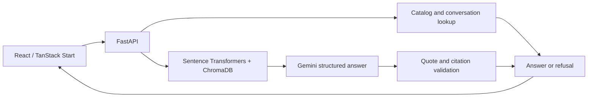

# StudentAssist-AI

StudentAssist-AI helps An-Najah National University students find information across study plans and academic regulations. Students can ask questions in Arabic or English and receive Arabic answers with citations to the university materials used. Team Triple Spark built the project for the IEEE RAG Hackathon.

## What it does

- Looks up course names, codes, and prerequisites directly in the catalog. Comparisons read each course's prerequisites from its own record.
- Retrieves evidence for general academic questions, including regulations, and asks Gemini to answer using the retrieved excerpts.
- Handles recent follow-up questions, including shared prerequisites. It asks for clarification when a course reference is ambiguous.
- Shows source links or document names and available page references. Unsupported questions return a refusal.

## Architecture



The React and TanStack Start frontend sends questions to FastAPI. The backend first checks whether it can resolve a course directly from catalog metadata. For other questions, multilingual Sentence Transformers embeddings and ChromaDB retrieve relevant excerpts. A lexical reranker helps surface regulations. Gemini returns a structured answer with evidence quotes, and the backend checks those quotes against the cited excerpts before returning source metadata.

| Path | Purpose |
| --- | --- |
| [`backend/`](backend/) | FastAPI, retrieval, course lookup, conversation handling, and evidence verification |
| [`backend/data/`](backend/data/) | University chunks and example evaluation questions |
| [`backend/tests/`](backend/tests/) | Dataset, retrieval, API, and grounding regression tests |
| [`backend/evaluation/`](backend/evaluation/) | Labeled cases, evaluation runner, and review workflow |
| [`frontend/`](frontend/) | React interface, Vite development proxy, and Bun lockfile |
| [`frontend/src/test/`](frontend/src/test/) | Chat, routing, and citation display tests |

## Local setup on Windows

You’ll need Python 3.12, Node.js 24 LTS, Bun, and a Gemini API key. The first use of the embedding model needs access to its weights unless they are already cached.

### Backend

Run from the project root in PowerShell.

```powershell
Set-Location backend
py -3.12 -m venv .venv
.\.venv\Scripts\python.exe -m pip install -r requirements.txt
if (-not (Test-Path -LiteralPath .env)) { Copy-Item .env.example .env }
```

Set `GEMINI_API_KEY` in the local `backend/.env` file, or provide it through the server process environment. Keep it out of Git and frontend variables. See [`backend/.env.example`](backend/.env.example) for the available settings.

```powershell
.\.venv\Scripts\python.exe -m uvicorn main:app --host 127.0.0.1 --port 8000
```

The backend uses `backend/data/chunks.json` by default. `GET /` checks liveness. The first nonblank question builds the in-memory index. See the [backend guide](backend/README.md) for the dataset contract, API behavior, and retrieval evaluation.

### Frontend

In a second PowerShell window, run from the project root.

```powershell
Set-Location frontend
bun install --frozen-lockfile
node .\node_modules\vite\bin\vite.js dev --host 127.0.0.1 --port 5173 --strictPort
```

Open [Triple Spark](http://127.0.0.1:5173). The Vite proxy sends `/api/ask` to FastAPI on port 8000. If the backend uses another address, set `RAG_BACKEND_URL` before starting Vite.

Try asking **ما المتطلب السابق لمساق مشروع تخرج 1 في هندسة الحاسوب؟**, then **شو اسم هاد المتطلب؟**. Open the citation to check the course record. When a source has no reliable page reference, the interface shows the source without a page label.

## Testing

From `backend`, run the offline test suite. It uses controlled embeddings and mocked Gemini calls.

```powershell
$env:PYTHON_DOTENV_DISABLED = '1'
try { .\.venv\Scripts\python.exe -B -m pytest -q -p no:cacheprovider }
finally { $env:PYTHON_DOTENV_DISABLED = $null }
```

From `frontend`, run the tests and type check after installing dependencies.

```powershell
node .\node_modules\vitest\vitest.mjs run
node .\node_modules\typescript\bin\tsc --noEmit
```

### macOS and Linux

These commands are provided for macOS and Linux. Verification for this update ran on Windows. Use Python 3.12, Node.js 24 LTS, and Bun.

```bash
cd backend
python3.12 -m venv .venv
. .venv/bin/activate
python -m pip install -r requirements.txt
test -f .env || cp .env.example .env
# Set GEMINI_API_KEY in the local .env file before starting the server.
python -m uvicorn main:app --host 127.0.0.1 --port 8000
```

In a second terminal from the project root:

```bash
cd frontend
bun install --frozen-lockfile
node node_modules/vite/bin/vite.js dev --host 127.0.0.1 --port 5173 --strictPort
node node_modules/vitest/vitest.mjs run
node node_modules/typescript/bin/tsc --noEmit
```

From `backend`, run `PYTHON_DOTENV_DISABLED=1 .venv/bin/python -m pytest -q` for offline tests. If the UI cannot connect, check FastAPI on port 8000 and the Vite proxy target. If the first question is slow, allow the index to finish building. If Gemini reports a quota or capacity error, check the provider status and try again later.

## RAG evaluation

The benchmark has 15 questions tied to the bundled corpus. It covers five course lookups, four policies, three challenging or consecutive questions, and three unsupported requests. The reference answers were checked against the labeled excerpts in the export. Applicability to particular students still depends on their program and plan.

From `backend`, run `python -m evaluation.run` with the project virtual environment active. Offline mode runs catalog lookups and vector retrieval using the configured embedding model. Gemini-dependent generation is skipped. Once the model is cached, set `HF_HUB_OFFLINE=1` in the process environment to keep model loading offline. To evaluate with Gemini, use `python -m evaluation.run --live` or select a small sample with `--case p1 --case u1`. Use `--output` to specify the report path stem. The runner writes JSON and Markdown.

- **Precision@K** divides the number of distinct labeled chunks in the final top K by K. Empty positions count as misses. **Recall@K** uses the number of labeled relevant chunk IDs as its denominator. Recall is undefined for unsupported questions. Catalog-only answers are excluded from vector metrics.
- **Refusal metrics** distinguish the observed refusal rate, correct refusal on unsupported cases, and incorrect refusal on answerable cases. Skipped generation and provider failures are excluded from these rate denominators and reported separately.
- **Citation metadata validation** checks the source and page against the captured evidence. Human review checks whether the answer is correct and whether the cited evidence supports its claims. The automated checks do not assign factual accuracy based on keyword overlap.

In the Windows offline benchmark at K=3, the seven vector cases averaged **23.8% Precision@3**, and the four answerable vector cases averaged **87.5% Recall@3**. All four policy questions retrieved at least one labeled relevant chunk. Eight catalog cases returned cited answers, and seven cases skipped generation. These results use a small set of explicit chunk labels and do not estimate accuracy on the full corpus.

The follow-up audit kept the same vector labels and matched the baseline at **23.8% Precision@3** and **87.5% Recall@3**. The grade-appeal check removed a medical-program excerpt from the context and returned the general rule with its page 80 citation. See the [source audit and live results](backend/evaluation/source-audit.md) for the per-case judgments, provider errors, and denominators.

For human review, read the result and captured evidence in the JSON report. Record judgments in a JSON mapping from case ID to `answer_correct`, `citations_support_answer`, and `notes`. Use `python -m evaluation.run --review-report evaluation/local-report.json --reviews reviews.json --output evaluation/local-report-reviewed`. Report the reviewed sample size when presenting those scores. The [evaluation guide](backend/evaluation/README.md) explains the review criteria.

## Academic data and chunking

The checked-in export has **1,114 chunks across 29 sources**. Chunk text has a minimum of **48**, maximum of **410**, median of **277.5**, and mean of **262.82** characters, counting Unicode code points. The lengths vary. Comparing successive chunks within each source in export order found **136 exact suffix-to-prefix matches of at least 30 characters**. This shows overlap in some records. The export alone does not establish a uniform overlap setting or the original preprocessing algorithm.

The cached multilingual MiniLM tokenizer measured **18–103 tokens**, with a median of **80.5** and mean of **76.11**, including special tokens and with truncation disabled. No exported chunk exceeded the model's 128-token limit in that check.

Course metadata contains a course code on 246 rows, including repeated metadata on continuation chunks. Course rows can preserve the code, name, and prerequisites together, while some policy passages and course descriptions continue in another chunk. There are 679 known page references and 435 `Unknown` pages. Citation display uses the supplied source and available page metadata.

## Development tools and runtime stack

Python, FastAPI, Pydantic, ChromaDB, Sentence Transformers, and the Gemini SDK power the backend. The UI uses React, TanStack Start, Vite, and Tailwind CSS. The project uses pytest, Vitest, Testing Library, and TypeScript for verification. Existing project documentation records Codex assistance for backend development and Lovable for frontend development. Gemini is a runtime answer-generation service.

## Grounding and limitations

- Catalog answers use the matching university records. For generated answers, citations identify excerpts containing the quoted evidence. Quote matching verifies the source of the quote. Whether it supports every claim still requires review.
- Academic rules can vary by program, plan version, or cohort. Confirm consequential decisions with the current university guide or an academic advisor.
- The first request can be slower because the backend builds the index in memory. Gemini-dependent requests can fail during provider outages, timeouts, or quota limits. The backend retries an upstream 503 once and returns an error if the service remains unavailable.
- The frontend sends a short recent conversation history. Ambiguous references may require the student to restate a course name or code.
- Coverage and freshness depend on the university export. Update the academic sources as regulations and study plans change.

## Future work

Expand academic and university coverage, gather larger independently reviewed evaluation sets, and measure retrieval and citation quality across programs. A production deployment would also need persistent indexing and load testing.

## Team

| Teammate | Role |
| --- | --- |
| Mira | Academic Data |
| Raneem | RAG/Backend |
| Lana | Frontend |
